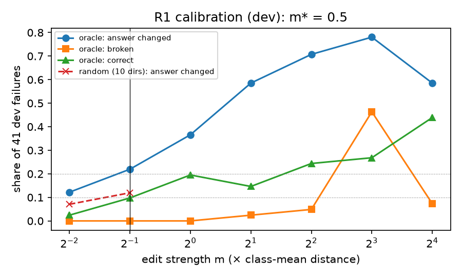

# R1: redesigned repair pilot (train + dev templates)

**Development result.** Labels: automatic (parser v4); S5 annotator kappa pending: development result. No test template is used. Code 7f621b5; Kaggle 2 × T4, 1.94 h session = **3.88 T4-hours** (cap 8).

## Calibration (41 dev failures, oracle edit)

| m | answer changed | broken | correct |
|---|---|---|---|
| 0.25 | 0.122 | 0.000 | 0.024 |
| 0.5 | 0.220 | 0.000 | 0.098 |
| 1.0 | 0.366 | 0.000 | 0.195 |
| 2.0 | 0.585 | 0.024 | 0.146 |
| 4.0 | 0.707 | 0.049 | 0.244 |
| 8.0 | 0.780 | 0.463 | 0.268 |
| 16.0 | 0.585 | 0.073 | 0.439 |

m\* = **0.5** (criterion met): the smallest m with ≥ 20% changed and ≤ 10% broken. 

Projection before the pilot: 6.55 T4-h with the 1.25 safety factor, 0.96 used; within budget.

Items: 107 failures ({'train': 66, 'dev': 41}), 107 matched solved items, 24 templates; solved drawn with replacement 27×, from other templates 0×. Self-sourced gate open on 50/107 failures and 17/107 solved items.

## Pilot at m\* (percentage points; 95% template-clustered bootstrap CIs)

Verdicts (all items, words fixed in prereg/R1.md): {'oracle': 'supported', 'self': 'inconclusive', 'eval': 'inconclusive'}.

### all (train + dev): 107 failures + 107 solved, 24 templates

| condition | repair | damage | net gain | p vs random | net − random mean | changed | broken |
|---|---|---|---|---|---|---|---|
| oracle | 15.0 [6.1, 29.3] | 0.0 [0.0, 0.0] | +7.5 [+3.1, +14.7] | 0.010 | +10.8 [+5.8, +14.2] | 15.0 | 0.5 |
| self | 10.3 [3.5, 23.0] | 8.4 [0.0, 20.9] | +0.9 [-6.8, +10.0] | 0.129 | +4.2 [-1.1, +8.9] | 12.6 | 0.5 |
| eval | 12.1 [3.3, 26.8] | 21.5 [6.0, 31.9] | -4.7 [-13.3, +9.1] | 0.713 | -1.4 [-6.4, +5.0] | 25.7 | 1.4 |
| random (100 dirs) | 10.7 | 17.3 | -3.3 (2.5–97.5%: -10.3, +2.3) | | | 19.5 | 0.9 |

### train: 66 failures + 66 solved, 16 templates

| condition | repair | damage | net gain | p vs random | net − random mean | changed | broken |
|---|---|---|---|---|---|---|---|
| oracle | 18.2 [6.5, 32.6] | 0.0 [0.0, 0.0] | +9.1 [+3.2, +16.3] | 0.010 | +10.2 [+2.3, +15.4] | 17.4 | 0.8 |
| self | 10.6 [2.3, 24.2] | 12.1 [0.0, 26.9] | -0.8 [-11.0, +11.0] | 0.495 | +0.4 [-2.8, +4.4] | 15.2 | 0.8 |
| eval | 13.6 [1.8, 29.2] | 16.7 [5.9, 24.6] | -1.5 [-10.0, +9.5] | 0.564 | -0.4 [-8.0, +4.9] | 26.5 | 2.3 |
| random (100 dirs) | 13.6 | 15.9 | -1.1 (2.5–97.5%: -7.6, +5.3) | | | 21.4 | 1.5 |

### dev: 41 failures + 41 solved, 8 templates

| condition | repair | damage | net gain | p vs random | net − random mean | changed | broken |
|---|---|---|---|---|---|---|---|
| oracle | 9.8 [1.1, 43.8] | 0.0 [0.0, 0.0] | +4.9 [+0.5, +21.9] | 0.010 | +11.6 [+3.5, +15.1] | 11.0 | 0.0 |
| self | 9.8 [1.1, 43.8] | 2.4 [0.0, 13.3] | +3.7 [-2.2, +21.4] | 0.020 | +10.4 [-2.0, +14.9] | 8.5 | 0.0 |
| eval | 9.8 [0.0, 47.6] | 29.3 [0.0, 41.4] | -9.8 [-20.0, +23.8] | 0.743 | -3.0 [-8.2, +15.8] | 24.4 | 0.0 |
| random (100 dirs) | 6.0 | 19.5 | -6.8 (2.5–97.5%: -18.3, +1.9) | | | 16.3 | 0.0 |

### content/binary items: 86 failures + 86 solved, 16 templates

| condition | repair | damage | net gain | p vs random | net − random mean | changed | broken |
|---|---|---|---|---|---|---|---|
| oracle | 10.5 [2.2, 26.2] | 0.0 [0.0, 0.0] | +5.2 [+1.1, +13.1] | 0.010 | +10.2 [+1.5, +14.5] | 11.6 | 0.0 |
| self | 7.0 [1.8, 19.6] | 9.3 [0.0, 25.0] | -1.2 [-9.8, +8.5] | 0.208 | +3.8 [-3.5, +9.8] | 12.2 | 0.6 |
| eval | 12.8 [2.8, 32.5] | 25.6 [7.7, 36.3] | -6.4 [-15.7, +11.4] | 0.663 | -1.5 [-7.6, +6.3] | 26.7 | 1.2 |
| random (100 dirs) | 10.5 | 20.3 | -4.9 (2.5–97.5%: -13.7, +1.7) | | | 20.1 | 1.0 |

### content/4-class items: 21 failures + 21 solved, 13 templates

| condition | repair | damage | net gain | p vs random | net − random mean | changed | broken |
|---|---|---|---|---|---|---|---|
| oracle | 33.3 [13.0, 57.1] | 0.0 [0.0, 0.0] | +16.7 [+6.5, +28.6] | 0.010 | +13.2 [+5.9, +21.6] | 28.6 | 2.4 |
| self | 23.8 [4.5, 50.0] | 4.8 [0.0, 12.0] | +9.5 [-2.0, +23.8] | 0.079 | +6.1 [-3.0, +17.1] | 14.3 | 0.0 |
| eval | 9.5 [0.0, 26.3] | 4.8 [0.0, 17.6] | +2.4 [-5.6, +11.8] | 0.743 | -1.0 [-8.6, +6.7] | 21.4 | 2.4 |
| random (100 dirs) | 11.5 | 4.7 | +3.4 (2.5–97.5%: -2.4, +9.5) | | | 17.0 | 0.5 |

### stable failures: 34 failures + 34 solved, 8 templates

| condition | repair | damage | net gain | p vs random | net − random mean | changed | broken |
|---|---|---|---|---|---|---|---|
| oracle | 2.9 [0.0, 14.3] | 0.0 [0.0, 0.0] | +1.5 [+0.0, +7.1] | 0.010 | +11.2 [+3.1, +16.4] | 10.3 | 1.5 |
| self | 0.0 [0.0, 0.0] | 17.6 [0.0, 42.9] | -8.8 [-21.4, +0.0] | 0.505 | +0.9 [-7.8, +7.6] | 14.7 | 0.0 |
| eval | 0.0 [0.0, 0.0] | 35.3 [11.8, 42.9] | -17.6 [-21.4, -5.9] | 0.970 | -7.9 [-11.5, -2.9] | 27.9 | 2.9 |
| random (100 dirs) | 4.1 | 23.6 | -9.7 (2.5–97.5%: -18.4, -2.9) | | | 20.2 | 0.4 |

### borderline failures: 73 failures + 73 solved, 21 templates

| condition | repair | damage | net gain | p vs random | net − random mean | changed | broken |
|---|---|---|---|---|---|---|---|
| oracle | 20.5 [8.7, 34.0] | 0.0 [0.0, 0.0] | +10.3 [+4.3, +17.0] | 0.010 | +10.6 [+4.9, +14.6] | 17.1 | 0.0 |
| self | 15.1 [5.7, 28.0] | 4.1 [0.0, 10.5] | +5.5 [-0.7, +13.1] | 0.069 | +5.8 [+0.6, +10.7] | 11.6 | 0.7 |
| eval | 17.8 [5.3, 33.3] | 15.1 [3.5, 26.4] | +1.4 [-8.8, +13.0] | 0.386 | +1.7 [-4.6, +8.2] | 24.7 | 0.7 |
| random (100 dirs) | 13.7 | 14.3 | -0.3 (2.5–97.5%: -6.8, +6.5) | | | 19.1 | 1.1 |

Oracle damage is 0 by construction (the oracle edit is zero on solved items, gold = bound).

## EXPLORATORY (not pre-registered, D51): repair and damage each against random

Net gain mixes repair with damage, and the oracle edit is never applied to solved items. Here each part is compared with the 100 random directions on its own. Points; CI of condition − random mean (template-clustered, 2,000 resamples); p = (1 + #random as good) / 101.

| part | set | n (templates) | random mean | oracle | self | eval |
|---|---|---|---|---|---|---|
| repair (failures) | all | 107 (24) | 10.7 | 15.0; +4.3 [-0.9, +11.7]; p 0.119 | 10.3; -0.4 [-5.0, +5.4]; p 0.564 | 12.1; +1.5 [-5.4, +9.1]; p 0.366 |
| repair (failures) | train | 66 (16) | 13.6 | 18.2; +4.6 [-3.6, +13.4]; p 0.257 | 10.6; -3.0 [-9.5, +4.8]; p 0.772 | 13.6; +0.0 [-10.4, +10.0]; p 0.515 |
| repair (failures) | dev | 41 (8) | 6.0 | 9.8; +3.8 [-1.1, +22.3]; p 0.218 | 9.8; +3.8 [-1.1, +22.3]; p 0.218 | 9.8; +3.8 [-3.0, +24.1]; p 0.218 |
| repair (failures) | borderline failures | 73 (21) | 13.7 | 20.5; +6.8 [-1.0, +14.9]; p 0.089 | 15.1; +1.3 [-4.5, +8.8]; p 0.406 | 17.8; +4.1 [-5.3, +13.5]; p 0.267 |
| repair (failures) | stable failures | 34 (8) | 4.1 | 2.9; -1.2 [-4.5, +2.9]; p 0.822 | 0.0; -4.1 [-12.1, -1.0]; p 1.000 | 0.0; -4.1 [-12.1, -1.0]; p 1.000 |
| damage (solved) | all | 107 (24) | 17.3 | 0.0; -17.3 [-25.1, -6.0]; p 0.010 | 8.4; -8.8 [-16.9, -0.1]; p 0.030 | 21.5; +4.2 [-4.7, +11.4]; p 0.871 |
| damage (solved) | train | 66 (16) | 15.9 | 0.0; -15.9 [-27.9, -5.1]; p 0.010 | 12.1; -3.8 [-7.5, +0.1]; p 0.317 | 16.7; +0.8 [-6.2, +9.1]; p 0.624 |
| damage (solved) | dev | 41 (8) | 19.5 | 0.0; -19.5 [-25.0, -3.5]; p 0.010 | 2.4; -17.0 [-24.8, +7.8]; p 0.040 | 29.3; +9.8 [-7.9, +16.2]; p 0.881 |
